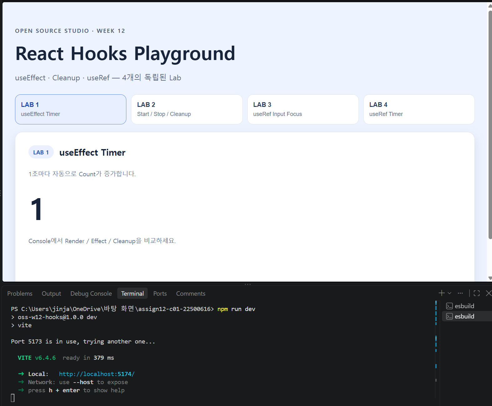

## 1. Project Information

React의 useEffect와 useRef를 실습하는 프로젝트다. 네 개의 Lab에서 타이머와 입력창 focus를 구현하고 컴포넌트가 사라질 때 cleanup이 어떻게 동작하는지 확인할 수 있었다.

- Starter Project: 2026-2-OSS/week12_starter_project (https://github.com/2026-2-OSS/week12_starter_project)
- GitHub Classroom 저장소: 2026-2-OSS/assign12-c01-22500616 (https://github.com/2026-2-OSS/assign12-c01-22500616)
- 개인 GitHub 저장소: Jin030121/assign12-c01-22500616 (https://github.com/Jin030121/assign12-c01-22500616)

## 2. Installation

```bash
npm install
npm run dev
```

이를 통해 터미널에 표시되는 Local URL을 브라우저에서 열어 앱을 확인할 수 있다. 
또한 운영용 빌드를 확인하려면 아래 명령을 실행해야한다.

```bash
npm run build
```


## 3. Source Code Exploration

main.jsx는 React 앱을 #root에 렌더링하고 공통 CSS와 React.StrictMode를 적용한다. App.jsx는 네 개의 Lab의 탭을 보여주고 현재 선택된 Lab을 렌더링한다. 이때,  탭을 바꾸면 이전 Lab 컴포넌트가 언마운트된다. src/components/에는 각 실습 컴포넌트가 있다. Lab1_EffectTimer.jsx는 자동 타이머 Lab2_TimerControl.jsx는 시작 및 중지 타이머, Lab3_InputFocus.jsx는 입력창 focus고 마지막 Lab4_RefTimer.jsx는 ref로 관리하는 타이머를 구현한다. 또한 App.css는 공통 화면 스타일을 담당한다.

**useEffect:** 화면이 렌더링된 뒤 타이머 같은 외부 작업을 설정할 때 사용한다. 의존성 배열 []는 마운트 시 설정하고 [running]은 처음과 running 값이 바뀔 때 설정한다. 배열을 생략하면 렌더링 후 매번 실행된다. Effect가 반환한 cleanup은 의존성 변경으로 Effect를 다시 실행하기 전과 컴포넌트가 언마운트될 때 실행된다. 타이머는 clearInterval로 정리해야 탭을 바꾼 뒤에도 계속 실행되는 문제를 막을 수 있다. 개발 환경의 React.StrictMode는 Effect 설정과 정리를 추가로 확인할 수 있다.

LAB 2의 Effect는 running이 참일 때만 interval을 만들고 cleanup에서 정리한다.

```jsx
useEffect(() => {
  if (!running) return;
  const timerId = window.setInterval(() => {
    setCount(prev => prev + 1);
  }, 1000);
  return () => window.clearInterval(timerId);
}, [running]);
```

setCount(prev => prev + 1)은 이전 상태를 기준으로 증가시켜서 타이머 콜백이 오래된 count값을 사용하는 문제를 피한다.

**useRef:** 렌더링이 다시 되어도 같은 ref 객체를 유지하고 .current에 값을 저장한다. 이때 , .current를 바꿔도 화면은 다시 렌더링되지 않는다. 화면에 표시할 count와 running은 useState로 관리하고 렌더링이 필요 없는 값은 useRef로 관리한다.

LAB 4는 timerRef.current에 타이머 ID를 저장한다. 이미 ID가 있으면 Start가 새 타이머를 만들지 않는다.

```jsx
const timerRef = useRef(null);
const start = () => {
  if (timerRef.current !== null) return;
  timerRef.current = window.setInterval(() => {
    setCount(prev => prev + 1);
  }, 1000);
  setRunning(true);
};
```

LAB 3은 ref={inputRef}로 입력 요소를 연결한 뒤 inputRef.current.focus()로 포커스를 옮긴다.

## 4. Lab Implementation

- **LAB 1 — useEffect Timer:** 1초마다 카운트를 올리고 언마운트될 때 interval을 정리한다. 다른 탭으로 이동하면 기존 Lab이 언마운트되어 타이머가 멈춘다. 다시 돌아오면 새 컴포넌트가 만들어져 카운트가 0부터 시작한다.
- **LAB 2 — Timer Start / Stop:** Start를 누르면 카운트가 올라가고 Stop을 누르면 멈춘다. Reset은 타이머를 멈추고 카운트를 0으로 바꾼다.
- **LAB 3 — Input Focus:** Focus는 입력창으로 포커스를 옮긴다. Clear는 입력 내용을 지운 뒤 입력창에 다시 포커스한다.
- **LAB 4 — useRef Timer:** Start / Stop / Reset으로 타이머를 제어한다. 타이머 ID를 ref에 보관해 중복 실행을 막고 언마운트될 때 cleanup으로 정리할 수 있다.

## 5. Lab Comparison

1. Dependency Array가 필요한 이유: Effect를 언제 다시 실행할지 정한다. 필요한 값이 바뀔 때만 타이머를 설정하고 정리할 수 있다.
2. Cleanup을 쓰지 않을 때 생길 수 있는 문제: 컴포넌트가 사라져도 타이머가 남아 계속 실행될 수 있다. 또한 탭을 여러 번 바꾸면 타이머가 중복되거나 불필요한 업데이트가 생길 수 있다.
3. useState와 useRef의 차이: useState값이 바뀌면 화면이 다시 렌더링된다.useRef의 .current가 바뀌어도 다시 렌더링되지 않는다. 화면에 보여줄 값은 state로 타이머 ID와 DOM 참조는 ref로 관리할 수 있다.
4. LAB 2와 LAB 4의 타이머 관리 방식: LAB 2는 running 상태가 바뀔 때 Effect가 타이머를 설정하고 cleanup한다. LAB 4는 버튼 함수가 ref에 저장한 타이머 ID를 직접 제어하고 컴포넌트가 사라질 때 Effect cleanup으로 정리한다.

## 6. Customizing

- index.html의 브라우저 탭 제목을 OSS W12 Hooks Lab으로 바꿨다.
- App.css에서 페이지 배경색을 #eef4ff, 기본 버튼 색을 #0f766e로 바꾸고 CSS를 읽기 좋게 정리하였다.
- 네 개의 Lab 파일에서 타이머, 입력 포커스, 상태 표시와 cleanup 동작을 구현하였다.

## 7. Deployment

- Vercel 배포 주소: [https://assign12-c01-22500616.vercel.app]
## 8. Weekly Review

*새롭게 배운 내용 3가지*

첫 번째로 useEffect의 의존성 배열로 Effect가 다시 실행되는 시점을 정할 수 있다는 것을 알게 되었고 두 번째로는 타이머 콜백에서 함수형 state 업데이트를 사용하면 이전 값을 기준으로 카운트를 안정적으로 올릴 수 있다는 것을 알게 되었다. 마지막 세 번쨰로 useState와 useRef는 값이 바뀔 때 화면이 갱신되는지가 다르다는 것을 깨닫게 되었다.

**어려웠던 점과 해결 방법**

처음에는 LAB 1에서 다른 탭으로 이동한 뒤 카운트가 0으로 돌아오는 것이 오류인지 헷갈렸다. App.jsx에서 탭을 바꾸면 기존 Lab이 언마운트되고 새 컴포넌트가 만들어지는 구조를 확인했다. 기존 타이머는 cleanup으로 정리되고 새 컴포넌트의 state는 0으로 시작하므로 정상 동작이라는 것을 이해할 수 있었다.

**AI 활용 내용 및 느낀 점**

AI를 사용해 Starter Project 구조와 Hook 동작을 개념적으로 분석하고 기억나지 않았던 Git 명령을 안내받을 수 있었다. 또한 설명을 읽고 코드를 확인한 뒤 Lab 코드를 직접 입력하고 Lab별로 커밋하였다. AI 설명을 참고하면서도 실제 코드와 실행 결과를 확인하는 과정이 중요하다는 것을 알 수 있게 되었다.